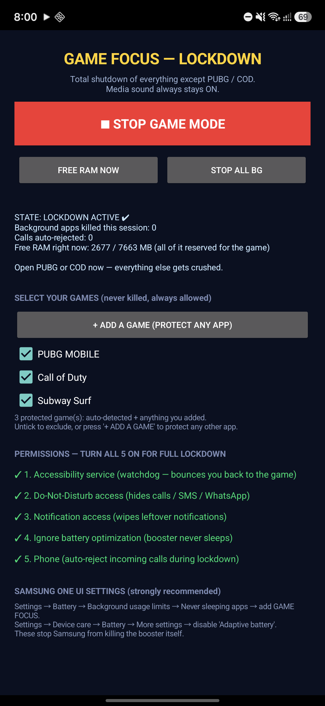

# 🎮 Gamer Pro — Android Game Lockdown & Performance Booster

> ✨ developed by **yaseenahmadexe** ✨

> Open-source Android app that puts your phone into **total gaming lockdown**: kills every background app/service, frees RAM, blocks calls/SMS/WhatsApp notifications, and dedicates all CPU/GPU/RAM priority to **PUBG Mobile** and **Call of Duty Mobile**. Built for Samsung Galaxy A16 (and other Android 9+ devices).



## ✨ Features

- **Total lockdown** — no app can open except PUBG Mobile / COD Mobile (accessibility watchdog bounces intruders back to the game).
- **RAM booster** — kills background processes every 10s and on demand ("FREE RAM NOW" / "STOP ALL BG").
- **Sound-safe Do-Not-Disturb** — PRIORITY mode with an explicit policy that **keeps game audio on** while hiding calls, SMS and WhatsApp notifications.
- **Auto call rejection** — incoming calls are ended automatically during lockdown.
- **Notification wipe** — every non-whitelisted notification is cancelled the moment it appears.
- **Auto-start** — open the app and lockdown starts by itself; survives reboots via `BootReceiver`.
- **Game whitelist** — PUBG Mobile (Global/BGMI/VN/KR) + COD Mobile (Global/Garena/KR) pre-configured; add any app via "+ ADD A GAME".
- **No gyroscope required** — works on devices without a gyro (e.g. Samsung A16).

## 📱 Screenshots

| Lockdown active |
|---|
|  |

## 🚀 Build & Install

Requirements: Android SDK (platform 36), Java 11+, `aapt2`, `d8`, `zipalign`, `apksigner`.

```bash
# compile resources + java
aapt2 compile --dir app/res -o build/res.zip
aapt2 link -o build/app.unaligned.apk -I $ANDROID_JAR --manifest app/AndroidManifest.xml build/res.zip
javac --release 11 -cp $ANDROID_JAR -d build/classes app/java/com/gamefocus/locker/*.java
# dex + inject + align
# (see .sharrowkin/scripts/rebuild.py for the full pipeline)
```

Or use the included helper:

```bash
python .sharrowkin/scripts/rebuild.py
```

Grant permissions over ADB:

```bash
python .sharrowkin/scripts/phone_focus_setup.py
```

## 🔐 Permissions

`KILL_BACKGROUND_PROCESSES`, `FOREGROUND_SERVICE`, `POST_NOTIFICATIONS`, `QUERY_ALL_PACKAGES`, `ACCESS_NOTIFICATION_POLICY`, `ANSWER_PHONE_CALLS`, `READ_PHONE_STATE`, `REQUEST_IGNORE_BATTERY_OPTIMIZATIONS`, `RECEIVE_BOOT_COMPLETED`.

## ⚠️ Honest notes

- This app **cannot change PUBG recoil or weapon stats** — those are server-side. Any app claiming to "fix recoil" is a cheat and risks a permanent ban.
- Lag improvements come from freeing RAM/CPU by killing background apps; in-game graphics settings are still up to you.
- Accessibility + DND + notification-listener access are required for full lockdown.

## 👤 Author

**Yaseen Ahmad** (GitHub: [@MrYaseen0](https://github.com/MrYaseen0))

- Profile: https://github.com/MrYaseen0
- Project: https://github.com/MrYaseen0/game-focus-lockdown

## 🤝 Contributing

PRs welcome. Please keep changes minimal and consistent with the existing structure. Open an issue for feature requests.

## 📄 License

MIT — see [LICENSE](LICENSE).

---

<!-- SEO / GEO metadata
title: GAME FOCUS - Android Game Lockdown & Performance Booster for PUBG Mobile & COD Mobile
author: Yaseen Ahmad
keywords: android game booster, pubg mobile booster, cod mobile booster, game lockdown, free ram, samsung a16, open source, yaseenahmad
-->

---

### Keywords (SEO)
android game booster, pubg mobile booster, cod mobile booster, game lockdown app, kill background apps android, free ram for gaming, dnd game mode, samsung a16 game booster, no gyroscope game app, open source android game optimizer, foreground service booster, accessibility watchdog android.